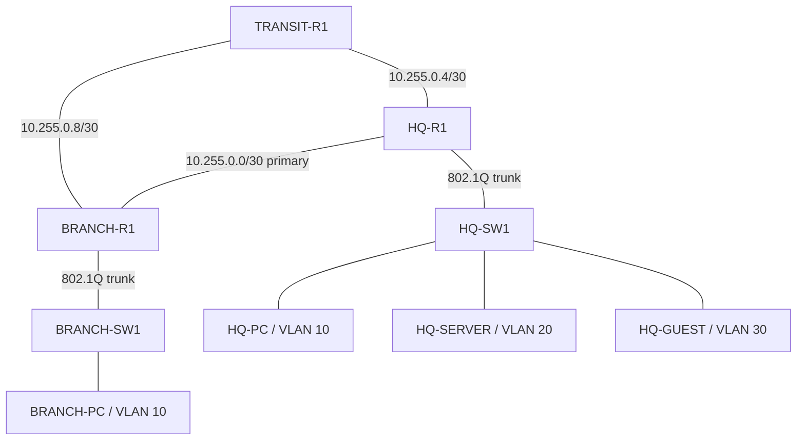

# Resilient HQ-to-Branch Network

## Purpose

Build and verify a two-site enterprise networking lab in Cisco Modeling Labs (CML). Demonstrate VLAN segmentation, router-on-a-stick, single-area OSPF, a backup WAN path, and guest access restrictions.

Environment: CML 2.10.0 on Hyper-V with 48 GB RAM assigned. Lab: **LinkedIn Portfolio - Resilient HQ and Branch**. Three IOL XE routers, two IOL XE switches, and four Alpine Linux hosts.

## Topology



## Addressing and VLANs

Site allocations: HQ `10.10.0.0/16`, branch `10.11.0.0/16`. Infrastructure reserve: `10.255.0.0/16`. Site allocations are planning boundaries; this single-area OSPF lab advertises individual subnets, without site summarization.

| Site | VLAN | Name | Subnet | Gateway |
|---|---:|---|---|---|
| HQ | 10 | EMPLOYEES | 10.10.0.0/22 | 10.10.0.1 |
| HQ | 20 | SERVERS | 10.10.4.0/22 | 10.10.4.1 |
| HQ | 30 | GUESTS | 10.10.8.0/22 | 10.10.8.1 |
| HQ | 99 | MANAGEMENT | 10.10.12.0/24 | 10.10.12.1 |
| Branch | 10 | EMPLOYEES | 10.11.0.0/22 | 10.11.0.1 |
| Branch | 99 | MANAGEMENT | 10.11.12.0/24 | 10.11.12.1 |

VLAN 99 gateways exist; switch management IPs and management-plane hardening are outside the completed scope. Each /22 has 1,022 usable addresses. This is a growth-oriented exercise rather than a measured production capacity plan.

| Router | Interface | WAN address | Peer |
|---|---|---|---|
| HQ-R1 | Ethernet0/0 | 10.255.0.1/30 | Branch Et0/0 |
| BRANCH-R1 | Ethernet0/0 | 10.255.0.2/30 | HQ Et0/0 |
| HQ-R1 | Ethernet0/1 | 10.255.0.5/30 | Transit Et0/0 |
| TRANSIT-R1 | Ethernet0/0 | 10.255.0.6/30 | HQ Et0/1 |
| TRANSIT-R1 | Ethernet0/1 | 10.255.0.9/30 | Branch Et0/1 |
| BRANCH-R1 | Ethernet0/1 | 10.255.0.10/30 | Transit Et0/1 |

## Switching and gateways

| Switch | Port | Role |
|---|---|---|
| HQ-SW1 | Et0/0 | Trunk to HQ-R1 Et0/2; allow 10,20,30,99 |
| HQ-SW1 | Et0/1 | Access VLAN 10; HQ-PC |
| HQ-SW1 | Et0/2 | Access VLAN 20; HQ-SERVER |
| HQ-SW1 | Et0/3 | Access VLAN 30; HQ-GUEST |
| BRANCH-SW1 | Et0/0 | Trunk to BRANCH-R1 Et0/2; allow 10,99 |
| BRANCH-SW1 | Et0/1 | Access VLAN 10; BRANCH-PC |

Create and name the VLANs, configure access membership, set 802.1Q trunk encapsulation, and restrict the trunk allowed lists. Native VLAN remains 1 in this lab. On each site router, enable Et0/2 without a parent IP and create subinterfaces `.10`, `.20`, `.30`, and `.99` as applicable. Match `encapsulation dot1Q` to the VLAN ID and apply the gateway addresses above.

Example HQ employee gateway:

```text
interface Ethernet0/2
 no ip address
 no shutdown
interface Ethernet0/2.10
 encapsulation dot1Q 10
 ip address 10.10.0.1 255.255.252.0
```

Verification:

```text
show vlan brief
show interfaces trunk
show spanning-tree interface Ethernet0/0 detail
show ip interface brief
show ip route connected
```

Observed: correct access membership and allowed VLAN lists; VLANs forwarding on trunks; router subinterfaces up/up with connected routes. The branch trunk initially showed no forwarding VLANs; subsequent STP output showed VLANs 10 and 99 designated forwarding, consistent with initial convergence.

## OSPF

Use process 10 and area 0. Router IDs: HQ `1.1.1.1`, branch `2.2.2.2`, transit `3.3.3.3`. Enable OSPF on both WAN interfaces and all site LAN subinterfaces. Use `passive-interface default` and remove passive mode only from WAN interfaces.

Example HQ process and direct WAN interface:

```text
router ospf 10
 router-id 1.1.1.1
 passive-interface default
 no passive-interface Ethernet0/0
 no passive-interface Ethernet0/1
interface Ethernet0/0
 ip ospf network point-to-point
 ip ospf cost 10
 ip ospf 10 area 0
interface Ethernet0/2.10
 ip ospf 10 area 0
```

Apply point-to-point OSPF network type on every WAN endpoint. Set cost 10 on both ends of the direct HQ–branch link and cost 50 on both ends of each transit link. Repeat LAN OSPF activation on each applicable subinterface. Observed LAN interface cost is 10, as reflected by the learned route metrics.

```text
show ip ospf neighbor
show ip route ospf
show ip route 10.11.0.10
copy running-config startup-config
```

Observed: all three routers had two FULL/- neighbors. HQ learned branch LAN routes through `10.255.0.2`, metric 20. Branch learned HQ LAN routes through `10.255.0.1`, metric 20. OSPF administrative distance is 110; it is distinct from route cost.

## Failover exercise and evidence

1. Confirm normal host connectivity and HQ's branch route.
2. Run `ping 10.11.0.10` continuously from HQ-PC.
3. Administratively shut HQ-R1 Et0/0, leaving the transit links up.
4. Capture the branch route and OSPF neighbors during the failure.
5. Restore Et0/0 with `no shutdown`.
6. Wait for adjacency recovery, capture the route and neighbors again, and stop the ping with Ctrl+C.
7. Save the restored configuration; do not save the temporary shutdown state.

| State | HQ next hop | Interface | Metric | HQ neighbors |
|---|---|---|---:|---|
| Baseline | 10.255.0.2 | Et0/0 | 20 | Branch and transit FULL |
| Direct interface shut | 10.255.0.6 | Et0/1 | 110 | Transit FULL |
| Direct interface restored | 10.255.0.2 | Et0/0 | 20 | Branch and transit FULL |

Backup cost: 50 + 50 + 10 = 110. Direct cost: 10 + 10 = 20.

My original continuous ping recorded **207 sent, 207 received, 0% loss**, RTT min/avg/max **2.849/3.563/4.657 ms**. No loss was observed at the ping sampling interval. This does not measure exact convergence time or guarantee lossless application traffic. The failure trigger was an administrative interface shutdown; silent forwarding failures and dead-timer behavior were not tested.

## Guest isolation

Apply this ACL inbound on HQ-R1's guest subinterface:

```text
ip access-list extended HQ-GUEST-IN
 remark Allow guest gateway ping
 10 permit icmp 10.10.8.0 0.0.3.255 host 10.10.8.1 echo
 remark Block guest access to internal addressing
 20 deny ip any 10.0.0.0 0.255.255.255
 remark Permit remaining traffic from guest subnet
 30 permit ip 10.10.8.0 0.0.3.255 any
interface Ethernet0/2.30
 ip access-group HQ-GUEST-IN in
```

| Source | Destination | Expected | Observed |
|---|---|---|---|
| HQ-GUEST | Gateway 10.10.8.1 | Permit | 4/4 replies |
| HQ-GUEST | HQ-PC 10.10.0.10 | Deny | 0/4 replies |
| HQ-GUEST | HQ-SERVER 10.10.4.10 | Deny | 0/4 replies |
| HQ-GUEST | BRANCH-PC 10.11.0.10 | Deny | 0/4 replies |
| HQ-GUEST | Management gateway 10.10.12.1 | Deny | 0/4 replies |
| BRANCH-PC | HQ-SERVER 10.10.4.10 | Permit | 4/4 replies |

`show ip interface Ethernet0/2.30` confirmed the inbound attachment. ACL counters showed 8 cumulative gateway permit matches and 16 deny matches, consistent with the four blocked four-packet tests. The last permit had no displayed matches.

The policy blocks routed guest traffic toward 10/8, except gateway echo requests. It does not isolate guests from each other within their VLAN, filter every private address range, or provide a stateful firewall. Return traffic from guests to internal initiators is also subject to the deny. No Internet, NAT, DHCP, or DNS service is configured or verified.

## Rebuildable Linux host configuration

| Host | Address | Gateway |
|---|---|---|
| HQ-PC | 10.10.0.10/22 | 10.10.0.1 |
| HQ-SERVER | 10.10.4.10/22 | 10.10.4.1 |
| HQ-GUEST | 10.10.8.10/22 | 10.10.8.1 |
| BRANCH-PC | 10.11.0.10/22 | 10.11.0.1 |

The Alpine BusyBox `ip` command does not support `ip -br addr`; use `ip addr show dev eth0`.

Editing `/etc/hostname` alone did not retain the running hostname after reboot: the CML boot script contained `hostname inserthostname-here` and overrode it. The CML configuration was locked until the individual node was stopped and wiped. Wiping discards that node's disk changes; preserve any needed data first and do not wipe the lab or routers.

The following startup script was installed and verified for HQ-PC. For the remaining hosts, substitute both hostname entries, both address entries, and both gateways using the table. Netmask remains 255.255.252.0. Set the local training account values privately; do not publish credentials.

```sh
# Sourced at boot by the CML Alpine image
hostname HQ-PC
echo HQ-PC > /etc/hostname

# Set these locally before applying; placeholders are not real credentials
USERNAME=cisco
PASSWORD=REPLACE_LOCALLY

cat > /etc/network/interfaces <<'EOF'
auto lo
iface lo inet loopback

auto eth0
iface eth0 inet static
    address 10.10.0.10
    netmask 255.255.252.0
    gateway 10.10.0.1
EOF

ip link set eth0 up
ip addr replace 10.10.0.10/22 dev eth0
ip route replace default via 10.10.0.1
```

HQ-PC was verified after rebuilding: correct hostname, /22 address, gateway, and 4/4 replies from the branch host. I verified the hostnames and expected connectivity after adapting the other three startup scripts, including the expected guest-to-server failure. A subsequent full-lab restart passed host and routing checks. On November 7, 2026, a fresh import of portfolio v2 also passed the acceptance checks recorded below.

## Completion and remaining work

- [x] VLAN membership, trunks, and gateway subinterfaces verified.
- [x] WAN connectivity and all OSPF adjacencies verified.
- [x] Employee host connectivity across sites verified.
- [x] Primary interface shutdown, alternate route, and restoration verified.
- [x] Guest restrictions and employee control test verified.
- [x] Host startup scripts configured and expected host tests verified.
- [x] Record full-lab restart and fresh-import acceptance tests.
- [x] Export and review portfolio v2; host password placeholders require local replacement.
- [x] Capture topology, ACL, failover, and VTP screenshots for publication.

This guide records my console outputs and test results from November 5–8, 2026. Configuration excerpts describe the implemented design; this is not a fresh device configuration export. Preserve router/switch startup configurations with `copy running-config startup-config`; export the CML lab separately for a portable artifact.


## Fresh-import validation — November 7, 2026

Validated artifact: `Resilient-HQ-Branch-portfolio-v2.yaml`, imported as a separate lab with host password placeholders set locally before boot.

The first portfolio revision failed to restore switch VLAN names and VLAN 99. VTP server mode kept VLAN information outside the extracted running configuration. After changing both switches to `vtp mode transparent`, saving, extracting, and exporting again, v2 restored the correct VLANs and names without manual VLAN creation. I confirmed transparent mode on both switches.

| Acceptance check | Observed result |
|---|---|
| HQ VLANs 10/20/30/99 and names | Restored automatically |
| Branch VLANs 10/99 and names | Restored automatically |
| OSPF on HQ, branch, transit | Two FULL neighbors on each |
| HQ-PC to 10.11.0.10 | 4/4 replies |
| BRANCH-PC to 10.10.4.10 | 4/4 replies |
| HQ-GUEST to 10.10.8.1 | 4/4 replies |
| HQ-GUEST to 10.10.4.10 | 0/4 replies, expected block |

I captured these results from the device consoles. Failover was verified earlier on the original lab; a repeat test was subsequently captured on November 8, as recorded below. The prior rebuild displayed one default route per host, although the original lab had duplicate defaults; no route-logic cleanup is claimed.


## Repeat failover and VTP screenshot evidence — November 8, 2026

The repeat test used the HQ-PC command `ping -i 1 10.11.0.10` (one probe per second). Route screenshots show:

| Stage | Next hop | Interface | Metric | HQ neighbors |
|---|---|---|---:|---|
| Before shutdown | 10.255.0.2 | Ethernet0/0 | 20 | Branch and transit FULL |
| Direct interface down | 10.255.0.6 | Ethernet0/1 | 110 | Transit FULL |
| After restoration | 10.255.0.2 | Ethernet0/0 | 20 | Branch and transit FULL |

The new ping summary shows **213 transmitted, 213 received, 0% packet loss**, RTT min/avg/max **2.896/3.666/6.230 ms**. It is separate from the original 207/207 test. The screenshot shows the summary, not the command invocation; the interval follows the test procedure. No exact convergence time or lossless application behavior is established.

Screenshots 06–09 capture the repeat failover sequence. Screenshots 10–11 show both switches in VTP transparent mode with the intended VLAN names: HQ 10/20/30/99 and branch 10/99. They show the current validated imported lab, not a before/after pair. Earlier clean-import acceptance evidence is recorded above.
