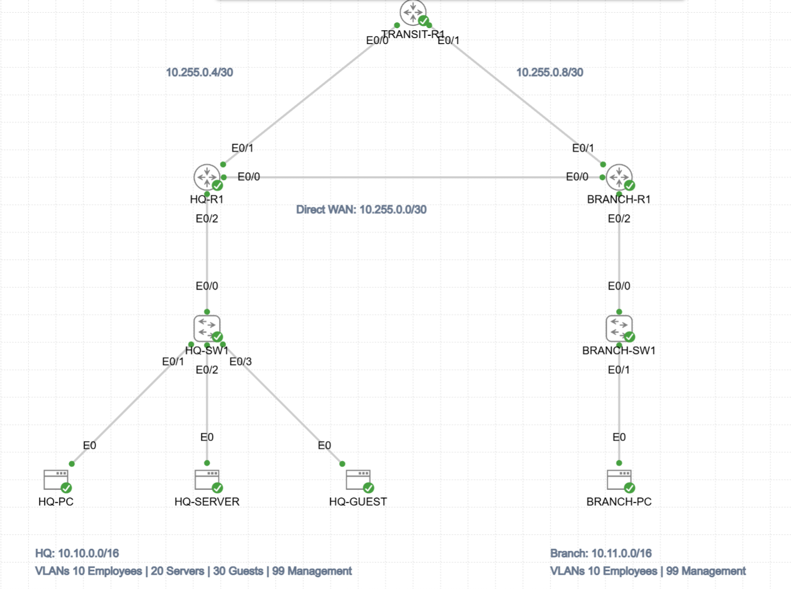

# Resilient HQ-to-Branch Network — OSPF Failover & Guest Isolation

A Cisco Modeling Labs portfolio project demonstrating VLANs, router-on-a-stick, single-area OSPF, WAN path preference and recovery, and routed guest access restrictions.

## Start here

- [Lab guide and results](LAB-GUIDE.md)
- [Reviewed CML YAML](Resilient-HQ-Branch-portfolio-v2.yaml)
- [Export preparation and validation](EXPORT-NOTES.md)

## Rebuild

1. Import the v2 YAML into CML as a separate lab.
2. Before starting the Linux hosts, replace each `PASSWORD=REPLACE_LOCALLY` assignment with a local training password. The placeholder is literal text, not an interactive prompt.
3. Start the lab and allow devices to boot and OSPF to converge.
4. Follow the guide's acceptance checks. The validated import automatically restored switch VLAN names and VLAN 99 with VTP transparent mode.

Uses IOL XE routers/switches and Alpine Linux images. Images and CML licenses are not included. Keep the lab isolated; this is a training design, not a production security baseline.

## Screenshot evidence

| Image | What it demonstrates |
|---|---|
| [Topology](screenshots/01-topology.png) | Nine devices, direct and transit WAN paths, site allocations |
| [OSPF](screenshots/02-ospf.png) | Two FULL HQ neighbors; direct branch route via 10.255.0.2 with metric 20 |
| [Guest blocked](screenshots/03-guest-blocked.png) | Guest-to-server test: 0 of 4 replies |
| [Employee permitted](screenshots/04-employee-permitted.png) | Branch-to-server test: 4 of 4 replies |
| [ACL counters](screenshots/05-acl-counters.png) | Four deny matches after the guest test |
| [Before failover](screenshots/06-before-failover.png) | Direct path, metric 20; two FULL neighbors |
| [During failover](screenshots/07-during-failover.png) | Transit path, metric 110; transit neighbor FULL |
| [After restoration](screenshots/08-after-restoration.png) | Direct path restored, metric 20; two FULL neighbors |
| [Repeat ping summary](screenshots/09-failover-ping.png) | 213/213 replies, 0% observed loss |
| [HQ VTP and VLANs](screenshots/10-hq-vtp-vlans.png) | Transparent mode; named VLANs 10/20/30/99 |
| [Branch VTP and VLANs](screenshots/11-branch-vtp-vlans.png) | Transparent mode; named VLANs 10/99 |

Screenshots were visually reviewed on November 7–8, 2026. CLI captures are readable at native size; open them individually when needed. The existing topology is retained as requested, including minor transit label overlap.

## Validation scope

The v2 clean import passed VLAN restoration, OSPF adjacency, employee connectivity and guest-isolation checks. Earlier original-lab failover changed the HQ branch route from metric 20 to 110 and back, while a continuous ping recorded 207/207 replies. The November 8 repeat test captured primary, transit, and restored routes plus 213/213 ping replies, using a one-second probe interval. Exact convergence time was not measured. The VTP images show the current validated imported lab; they are not a before/after comparison.

No original exports containing local passwords or social publishing drafts are included in this package.
